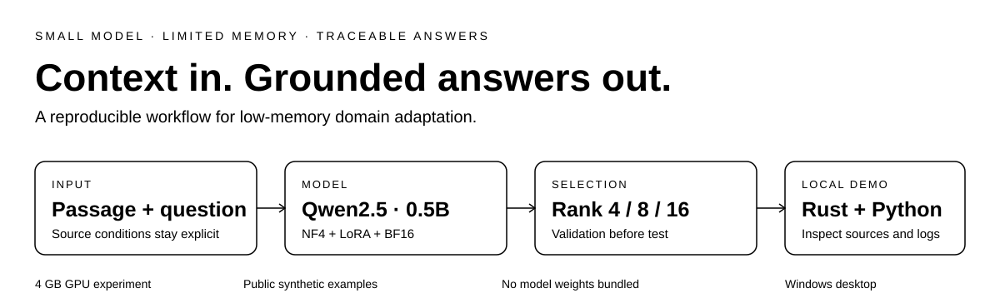
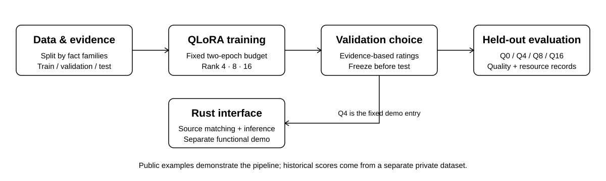

<div align="center">

# Campus QA · QLoRA

**4GB 显存上的中文领域问答微调与本地演示**

Qwen2.5-0.5B-Instruct · QLoRA · Rust / egui · Python

[快速开始](#快速开始) · [实验结果](#实验结果) · [运行指南](docs/REPRODUCE.md) · [数据说明](docs/DATA.md)

</div>



一个从**资料整理、参数高效微调、验证集选择到本地界面**的完整实验项目。模型接收“资料片段＋问题”，在给定证据下生成中文回答；界面展示资料来源与模型原回答，便于回查。

> **公开范围**：本仓库提供代码、配置模板、独立创作的合成数据及历史聚合指标。真实校园材料、个人信息、论文、模型权重与逐题运行记录不公开。**公开示例不能复现历史实验分数。**

## 项目特点

| 低显存训练 | 受控配置比较 | 可回查的本地演示 |
| --- | --- | --- |
| 4位 NF4、双重量化、BF16、梯度累积和梯度检查点 | 比较 LoRA rank 4 / 8 / 16，固定 alpha/r＝2，其余主要条件一致 | Rust/egui 界面连接 Python 推理，保留资料、来源、回答和日志 |
| 原实验在 RTX 3050 Ti Laptop 4GB 上完成 | 验证集先选择配置，再报告统一测试结果 | 关键词匹配、手动资料输入、原回答复制与软件内部截图 |

**Q4 / Q8 / Q16 指 LoRA 的秩。三组基座均采用4位量化。** Q0 是同样量化、未做本项目领域适配的指令模型基线。

## 实验流程



训练采用给定资料监督微调；评测时不把参考回答拼入生成提示。验证损失用于确定训练预算，验证回答评分用于选择配置，两者用途分别记录。系统演示与正式给定资料测试分别解释。

## 快速开始

### 1. 准备环境与基座

原实验环境为 **Windows / Python 3.11 / PyTorch 2.8.0+cu126**。先在自己的虚拟环境安装匹配显卡驱动的 CUDA 版 PyTorch，再安装其余依赖：

```text
git clone https://github.com/xuasas/campus-qa-qlora.git
cd campus-qa-qlora
python -m pip install -r requirements.txt
```

自行取得 **Qwen2.5-0.5B-Instruct** 本地目录，包含配置、分词器及 `model.safetensors`。模型权重不随仓库提供。

### 2. 检查数据并生成本机配置

```text
python scripts/prepare_local.py --check-data-only
python scripts/prepare_local.py --model-path "<本地基座目录>"
python scripts/train_formal.py --rank 4 --check-only
```

默认使用 **16条训练 / 4题验证 / 4题测试**的合成数据。前两项检查不启动训练；第三项核对配置与 GPU 条件。真实授权数据可通过 `--data-dir "<私有数据目录>"` 指定，格式见[数据说明](docs/DATA.md)。

### 3. 运行训练与本地界面

```text
python scripts/train_formal.py --rank 4
```

完成自己的 Q4 训练后，从仓库根目录启动界面：

```text
$env:QLORA_ROOT = (Get-Location).Path
$env:QLORA_PYTHON = (Get-Command python).Source
cargo run --locked --manifest-path demo_rust/Cargo.toml
```

以上界面命令在 PowerShell 中执行。界面按 **Windows 桌面版**提供，需 Rust 1.95 或以上及相应构建工具；中文字体从系统读取。Q4 是固定演示入口，不会自动切换为其他验证候选。

完整的三秩训练、评分填写、验证集选择与测试命令见[运行与复现指南](docs/REPRODUCE.md)。

## 实验结果

以下为**原私有数据上的历史结果**，不是仓库内合成数据的运行结果。原实验按202个事实家族划分为248条训练、40题验证及60题测试，在读取测试结果前由验证集选定 Q4。

| 配置 | LoRA rank | ROUGE-L ↑ | corpus BLEU-4 ↑ | 助手辅助均分 / 5 ↑ |
| :--- | ---: | ---: | ---: | ---: |
| Q0 基线 | — | 25.63 | 4.84 | 2.983 |
| **Q4 验证集选定** | **4** | **50.80** | **23.98** | **4.050** |
| Q8 | 8 | 51.21 | 25.46 | 3.983 |
| Q16 | 16 | 52.63 | 26.72 | 4.017 |

Q4 在本次验证规则下被选定，以较小适配器取得接近较大秩候选的辅助评分；Q16 的文本重叠指标最高。候选间差异较小，不能据此证明某一秩普遍最优。

<details>
<summary><strong>查看训练资源记录与测量范围</strong></summary>

| 配置 | 可训练参数 | 适配器 / MiB | 入口耗时 / 秒 | 分配峰值 / GiB | 保留峰值 / GiB |
| :--- | ---: | ---: | ---: | ---: | ---: |
| Q4 | 2,199,552 | 8.43 | 394.94 | 1.231 | 1.846 |
| Q8 | 4,399,104 | 16.82 | 455.38 | 1.264 | 1.881 |
| Q16 | 8,798,208 | 33.60 | 451.85 | 1.330 | 1.949 |

入口耗时包含入口内部准备、训练、验证及保存。显存峰值从训练开始回调重置后记录，不包含此前加载峰值，也不等于整张显卡占用。适配器体积不包含基座与运行环境。

</details>

评分由助手辅助完成，**未实施独立真人盲评**，仅有一个训练种子。Q0 有4条测试输出达到256 token上限，均保留在评价中。ROUGE-L、BLEU-4与分级评分均不等于业务准确率；原始逐题数据未公开，聚合指标无法替代独立复核。

完整公开数值见[历史结果汇总](results/historical_summary.json)。

## 仓库结构

```text
campus-qa-qlora/
├── assets/                 README 黑白概览图与流程图
├── configs/templates/      rank 4 / 8 / 16 参数模板
├── data/synthetic/         合成问答、元数据与划分说明
├── demo/                   合成演示题与来源片段库
├── demo_rust/              Windows Rust / egui 界面源码
├── scripts/                训练、生成、评分、选择与安全扫描
├── results/                历史聚合结果
└── docs/                   运行、数据、上传与核验说明
```

## 使用边界与文件安全

模型仍可能出现计算错误、条件遗漏、无依据断言和资料误配。字符关键词匹配是演示功能，未经过独立端到端准确率评价。需要查看原文与适用条件，不能把功能运行成功解释为完整教务业务可靠性。

`configs/runtime/`、私有数据、权重及运行记录由 `.gitignore` 排除。公开包自带快照，可检查文件是否保持一致：

```text
python scripts/check_public_files.py --verify-snapshot
```

扫描覆盖预设的敏感内容规则，不保证未来新增文件均安全。修改源码后快照会出现差异，应审查后更新清单。

| 文档 | 内容 |
| :--- | :--- |
| [运行与复现指南](docs/REPRODUCE.md) | 环境、预算预实验、正式训练、评分与模型选择 |
| [数据说明](docs/DATA.md) | 合成数据、真实数据格式、事实家族与来源字段 |
| [核验记录](docs/VALIDATION.md) | 配置、流程、Rust编译及既有界面核对 |
| [上传与脱敏说明](docs/UPLOAD.md) | 公开范围、忽略规则及新增文件注意事项 |

## 许可

项目代码尚未指定开源许可证。基座模型与依赖遵循各自许可，仓库不重新分发模型权重或系统字体。
